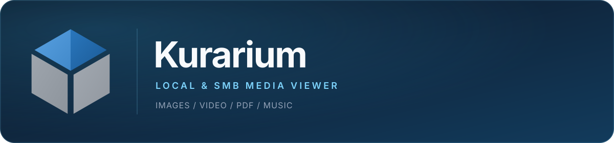

Windows向けのローカル/SMBメディアビューアです。ローカルサーバーが提供するブラウザUIから、画像、動画、PDF、音楽を閲覧できます。画面表示は日本語のみに対応しています。

## プロジェクトの状態

Kurariumは現在**パブリックベータ**です。Windows向けバイナリは**コード署名されていない**ため、SmartScreenの警告が表示される場合があります。公開されているSHA-256チェックサムを確認し、リリースを実行する前にソースを確認してください。

本プロジェクトは、信頼できるローカルネットワーク上での個人利用を想定しています。インターネットへ直接公開する設計ではありません。

## 対応プラットフォーム

- Windows 11 (x64)

## 配布

リリースはGitHub Releasesで公開します。

- `Kurarium-Installer-<version>-win-x64.exe`: ユーザー単位のインストーラー（管理者権限は不要）
- `Kurarium-Portable-<version>-win-x64.zip`: ポータブル版
- `SHA256SUMS.txt`: リリース資産のチェックサム
- `LEGAL-NOTICES.zip`: ライセンス条文と第三者ソフトウェアの通知
- `FFMPEG-SOURCE.zip`: 対応するFFmpegソースアーカイブとビルドスクリプト
- `SBOM.cdx.json`: CycloneDX形式のソフトウェア部品表（SBOM）

### 未署名ビルド

パブリックベータのリリースは**コード署名されていません**。Windows SmartScreenにより「WindowsによってPCが保護されました」などの警告が表示される場合があります。公開されたSHA-256チェックサムと一致する場合に限り、**詳細情報**を選択してから**実行**してください。

LAN HTTPSで使用する自己署名証明書は、Windowsのコード署名とは別です。LAN通信は暗号化されますが、インストーラーや実行ファイルの信頼された発行元を証明するものではありません。

PowerShellでダウンロードを検証します。

```powershell
Get-FileHash .\Kurarium-Installer-0.5.0-win-x64.exe -Algorithm SHA256
```

結果を`SHA256SUMS.txt`の該当行と比較してください。

## インストール

1. インストーラーを実行します。
2. スタートメニューまたはデスクトップのショートカットから**Kurarium**を起動します。
3. **設定 > ライブラリ**でライブラリを追加します。フォルダボタンでエクスプローラーからローカルフォルダを選択するか、パスを直接入力します。
4. スキャンを開始します。

アプリはシステムトレイに常駐します。サーバーを停止して完全に終了するには、トレイメニューの**終了**を使用してください。

## ポータブル版

ZIPを書き込み可能なフォルダに展開し、`Kurarium.exe`を実行します。ユーザーデータは実行ファイルと同じフォルダの`data`に保存されます。そのフォルダに書き込めない場合、Kurariumは`%LOCALAPPDATA%\Kurarium`へフォールバックします。

ポータブル版の更新では、Kurariumを終了してから、新しいZIPを既存フォルダへ上書き展開します。`data`フォルダは保持されます。

## データの保存先

- インストール版: `%LOCALAPPDATA%\Kurarium\data`
- ポータブル版: `<展開先フォルダ>\data`
- データベース: `data\mediaviewer.db`
- サムネイル: `data\thumbs.db`
- トランスコードキャッシュ: `data\transcoded`
- サーバー設定: `data\.system\config.ini`
- LAN TLS証明書と秘密鍵: `data\.system\tls`

## アンインストール

Windowsのアンインストーラーは、ユーザーデータを削除するか確認します。既定では削除されます。保持する場合は**いいえ**を選択してください。

## サムネイルキャッシュ

サムネイルは表示領域付近の項目についてオンデマンドで生成され、`data\thumbs.db`に保存されます。既定のキャッシュ上限は**512 MB**です。上限を超えると、最終使用日時が最も古いサムネイルから削除されます。任意の保持期間（TTL）は**既定で無効**です。

**設定 > システム > サムネイルキャッシュ**で設定します。上限は128 MBから4096 MBまで設定できます。TTLを有効にすると、最後にアクセスしてから設定した日数が経過したサムネイルが期限切れになります。アップグレード時にキャッシュが縮小される場合がありますが、元のメディアファイルは変更されません。

SMBパスワードはデータベースや設定ファイルには保存されません。Windows資格情報マネージャーに保存されます。パスワードはプロセスのコマンドラインではなく標準入力経由で資格情報ヘルパーに渡されます。新規または変更したSMB接続を保存する前に、指定した資格情報と共有アクセスをテストし、成功した場合にのみ接続を保存します。

### 開発ビルドからの移行

開発サーバーはプロジェクト内の`data/`にデータを保存します。既存のライブラリデータベースとサムネイルを引き継ぐには:

1. Kurariumと開発サーバーを停止します。
2. プロジェクトの`data`フォルダを`%LOCALAPPDATA%\Kurarium\data`へコピーします。
3. インストール版を起動します。

メディアのパスは絶対パスで保存されます。ドライブレターやフォルダの場所が変わった場合は、コピー後に再スキャンしてください。

## LANアクセス

既定では、サーバーはHTTPで`127.0.0.1`をリッスンし、ログインは不要です。

LAN上の他の端末にライブラリを公開するには:

1. **設定 > システム**でログインユーザー名と**5文字以上**のパスワードを設定します。
2. **ローカルネットワーク内に公開**を有効にします。ポート欄が編集可能になります。
3. 設定を保存し、Kurariumを再起動します。
4. 設定画面からLAN証明書をダウンロードし、各クライアントで信頼します。
5. プロンプトが表示されたら、WindowsファイアウォールでKurariumを許可します。

LAN公開が無効な場合、KurariumはHTTPで`127.0.0.1`をリッスンします。有効な場合は**HTTPS**で`0.0.0.0`をリッスンし、ログインを要求します。LAN公開中はHTTPへフォールバックしません。保存済みのホストが現在のPCで利用できない場合は、ローカルでの復旧用に`127.0.0.1`へフォールバックします。

### 自己署名証明書

Kurariumは初回のLAN起動時に自己署名証明書を生成します。証明書には`localhost`、PCのホスト名、生成時点のLANアドレスが含まれます。有効期限は365日です。

証明書は**設定 > システム > HTTPS証明書**から取得できます。ダウンロードした`kurarium-lan.cer`を各クライアント端末の信頼されたルートストアへインストールしてください。証明書が信頼されていない場合、ブラウザに警告が表示されます。設定画面に表示されるフィンガープリントを確認していない限り、警告を迂回しないでください。

PCのLANアドレスが変わると、設定画面に証明書が現在のアドレスをカバーしていない旨の警告が表示されます。証明書を再生成し、各クライアントで新しい証明書を信頼してください。再生成すると古い証明書は無効になります。

Windows、Chrome/Edge、Firefox、iOS、Androidでの証明書インストール手順は[docs/LAN_HTTPS.md](docs/LAN_HTTPS.md)を参照してください。

LANアクセスは信頼できるネットワーク専用です。5文字という最小文字数は利便性のための設定であり、推奨値ではありません。長く一意なパスワードを使用してください。ログイン失敗はクライアントIP単位でレート制限されます（15分間に5回）。LANポートをインターネットへ直接公開しないでください。

## 開発

要件: Node.js 22以上、`PATH`上のffmpeg/ffprobe。

```powershell
npm install
npm --prefix backend install
npm --prefix frontend install

npm --prefix backend run dev
npm --prefix frontend run dev
```

開発サーバーは<http://127.0.0.1:3000>で動作します。Vite開発サーバーがAPIリクエストをプロキシします。

### E2Eスモークテスト

Playwrightはフロントエンドをビルドし、本番バンドルを配信する分離バックエンドを起動し、3枚の画像を投入して、ギャラリー、ライトボックス、キャッシュ設定のスモークテストを実行します。

```powershell
npm run test:e2e:install
npm run test:e2e
```

### 本番ビルド

```powershell
npm run build
npm run dist
```

`npm run dist`はインストーラーとポータブルZIPを`release/`に生成します。パッケージングにはFFmpegバイナリが必要で、別途取得します。

```powershell
npm run fetch:ffmpeg
npm run fetch:ffmpeg-source
npm run dist
```

`npm run fetch:ffmpeg-source`は、同梱するFFmpegバイナリに正確に対応するソースとビルドスクリプトを含む`release/FFMPEG-SOURCE.zip`を生成します。

リリースと署名の手順は[docs/RELEASE.md](docs/RELEASE.md)と[docs/SIGNING.md](docs/SIGNING.md)に記載しています。コンポーネント構成は[docs/ARCHITECTURE.md](docs/ARCHITECTURE.md)を参照してください。

## テスト

```powershell
npm test
npm run typecheck
```

## ライセンス

KurariumはMITライセンスです。[LICENSE](LICENSE)を参照してください。

同梱の第三者コンポーネントは、それぞれのライセンスに従います。[THIRD_PARTY_NOTICES.md](THIRD_PARTY_NOTICES.md)を参照してください。

セキュリティ報告は[SECURITY.md](SECURITY.md)、プライバシーは[PRIVACY.md](PRIVACY.md)を参照してください。コントリビューションガイドラインは[CONTRIBUTING.md](CONTRIBUTING.md)にあります。

FFmpegはGNU General Public License version 3で配布されています。同梱ビルドの設定とソースの入手方法は[THIRD_PARTY_NOTICES.md](THIRD_PARTY_NOTICES.md)に記載しています。
